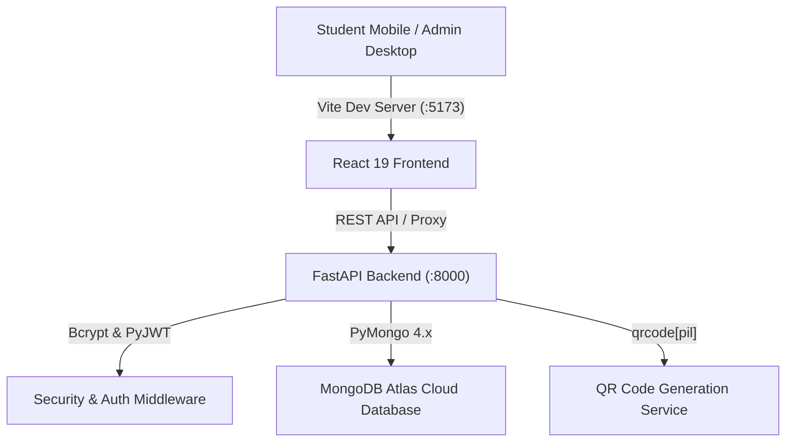
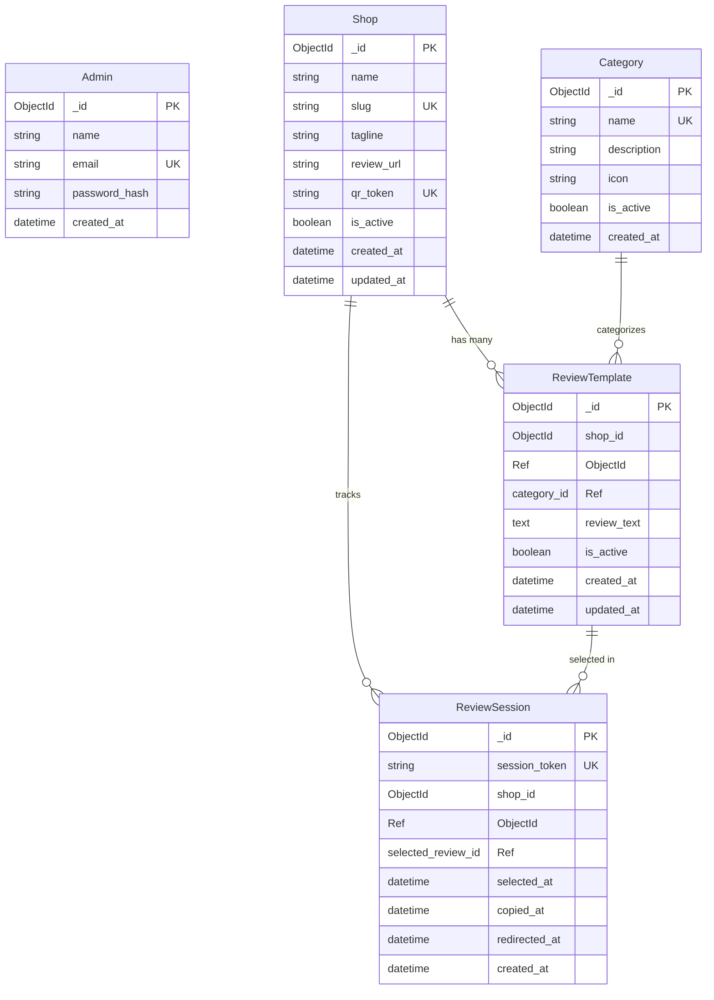

# Dhankranti Share Market Classes — Complete Technical Walkthrough & Architecture Report

> **Company:** Dhankranti Share Market Classes ([dhankranti.com](https://dhankranti.com/))  
> **System:** Student Review Assistance MVP (Fully Runnable)  
> **Repository Root:** `c:\Users\madhu\Desktop\OutReach_System`

---

## 1. Executive Summary

The **Dhankranti Student Review System** is an MVP web application built specifically for **Dhankranti Share Market Classes** to eliminate student friction when leaving Google Reviews after attending classes.

Instead of forcing a student to write a review, Dhankranti places a QR code at the counter. The student scans the code, chooses an educational experience theme (e.g., *Teaching Quality*, *Practical Learning*, *Supportive Mentors*), taps one of 10 prewritten authentic reviews, copies it to clipboard with one tap, and the app opens Google Reviews in a new tab where the student pastes and submits.

### Key Numbers
- **8 educational categories** (Teaching Quality, Practical Learning, Supportive Mentors, Beginner Friendly, Course Content, Live Market Sessions, Doubt Solving, Overall Experience)
- **80 prewritten reviews** (10 per category) — realistic, referencing Ram Sir and actual market concepts
- **0 fake profit claims** — all reviews focus on educational value
- **Session-based tracking** — anonymous, non-destructive review reuse

---

## 2. Core Architecture & Stack Decisions



### Technology Matrix
| Layer | Technology | Key Details |
|---|---|---|
| **Frontend Framework** | React 19 + Vite 8 | Fast HMR, clean component tree |
| **Routing** | React Router v7 | Mobile sub-steps and protected admin routes |
| **Styling** | Vanilla Custom CSS | **Zero Tailwind**; Dhankranti brand design system (Navy `#1e3a8a`, Green `#059669`) |
| **Icons** | Lucide React | Pure SVG education-themed icons (graduation-cap, line-chart, etc.) |
| **QR Library** | qrcode.react | Vector rendering with high error correction (`H`) and PNG download |
| **Backend API** | Python 3.13 + FastAPI | Asynchronous REST API with OpenAPI docs |
| **Database** | MongoDB Atlas + PyMongo | Cloud NoSQL with automatic unique and performance indexes |
| **Authentication** | PyJWT + Bcrypt | Secure hashing, Bearer tokens |

---

## 3. Database Schema & Relational Design



### Critical Non-Destructive Review Rule
When a student selects a review, **the review is NEVER deleted from the database**. The student's selection is bound to an anonymous `ReviewSession` row. The review template remains permanently available for all subsequent students.

---

## 4. Student Flow (Mobile UI/UX Breakdown)

The student interface is mobile-first (designed for 360px–440px viewports).

### Screen 1: Combined Brand & Category Selection (After Scanning QR)
- **URL Route:** `/r/dhankranti`
- **Visuals:** Official Dhankranti logo prominently displayed, business name "Dhankranti Share Market Classes"
- **Prompt:** *"Share your Dhankranti experience"*
- **Grid:** Immediate 2-column grid of 8 educational categories (no separate landing page):
  1. 🎓 **Teaching Quality** — Ram Sir's teaching approach
  2. 📈 **Practical Learning** — Real chart analysis, live market practice
  3. 👥 **Supportive Mentors** — Guidance and mentorship quality
  4. 🌱 **Beginner Friendly** — Accessibility for new students
  5. 📖 **Course Content** — Curriculum depth and structure
  6. ⚡ **Live Market Sessions** — Real-time market analysis sessions
  7. 💬 **Doubt Solving** — Q&A responsiveness and support
  8. ⭐ **Overall Experience** — General satisfaction

### Screen 2: Review Selection
- **Header:** Category icon + category name with back arrow
- **Cards:** 10 full-width clickable review cards per category
- **Interaction:** Tapping a card highlights it with blue border and checkmark

### Screen 3: Confirmation & Action
- **Card:** Selected review displayed prominently
- **Primary Button:** `[ Copy & Open Google Review ]`
  - Copies text to clipboard (`copied_at` timestamp)
  - Opens Google Reviews in new tab (`redirected_at` timestamp)
  - Button transforms to `✓ Review Copied — Opening Google...`
- **Secondary Button:** `[ Choose Another Review ]`
- **Popup Blocker Fallback:** Direct link with instructions if popup is blocked

---

## 5. Admin Portal Screens

The admin panel uses a dark navy sidebar layout with Dhankranti logo and navigation groups (MAIN, MANAGEMENT, ACTIVITY, SYSTEM).

### Login (`/admin/login`)
- Dhankranti-branded login card
- Dev credentials: `admin@example.com` / `Admin@123`

### Dashboard (`/admin/dashboard`)
- **4 Metric Cards:**
  - 🏪 Active Shops
  - 📑 Review Categories
  - 💬 Review Templates
  - ⏱ Review Sessions
- **Recent Student Activity Table:** Shows latest review interactions

### Shops (`/admin/shops`)
- Table: Shop Name, Review URL, Status, Actions (Open, QR, Edit, Deactivate)
- QR Modal: High-res QR code + Download PNG, Print, Copy Link, Open Page

### Categories (`/admin/categories`)
- Table columns: **Icon | Category | Description | Review Count | Status | Actions**
- Actions: Toggle active/inactive, Edit, Delete (with protection if reviews exist)

### Reviews (`/admin/reviews`)
- **3 Filters:** Shop dropdown, Category dropdown, Status dropdown (Active/Inactive)
- Table columns: Review Text | Category | Shop | Status | Created | Actions
- Actions: Toggle active/inactive, Edit, Delete
- Add/Edit Modal: Character counter `0 / 300`, placeholder referencing Ram Sir

### Sessions (`/admin/sessions`)
- Table columns: **Shop | Category | Selected Review | ✓ Selected | ✓ Copied | ✓ Opened | Time**
- No raw session token clutter in main table
- Detail modal with full audit timestamps and anonymous session token

---

## 6. Complete API Endpoint Catalog

### Authentication
- `POST /api/auth/login` — Authenticate admin, returns JWT Bearer token
- `GET /api/auth/me` — Get authenticated admin profile

### Public Student Flow
- `GET /api/public/review/{qr_token}` — Fetch shop details, active categories, and active reviews (also accepts slug)
- `POST /api/public/sessions` — Initialize anonymous session
- `POST /api/public/sessions/{session_token}/select` — Record chosen review ID
- `POST /api/public/sessions/{session_token}/copy` — Record clipboard copy timestamp
- `POST /api/public/sessions/{session_token}/redirect` — Record external redirect timestamp

### Admin Management (JWT Protected)
- `GET /api/admin/dashboard` — Dashboard metrics
- `GET/POST /api/admin/shops` — List/Create shops
- `PUT/DELETE /api/admin/shops/{id}` — Update/Delete shop
- `GET /api/admin/shops/{id}/qr` — Fetch QR code data URI
- `GET/POST /api/admin/categories` — List/Create categories (with review counts)
- `PUT/DELETE /api/admin/categories/{id}` — Update/Delete category
- `GET /api/admin/reviews` — List reviews (filter by `shop_id`, `category_id`, `is_active`)
- `POST /api/admin/reviews` — Create review template
- `PUT/DELETE /api/admin/reviews/{id}` — Update/Delete review template
- `GET /api/admin/sessions` — Customer review sessions audit log

---

## 7. Automated Test Suite Results

Backend test suite (`backend/test_api.py`) — **16 tests**, all passing:

```text
--- Starting Backend API Test Suite ---
PASS: Health check
PASS: Public review page loaded shop 'Dhankranti Share Market Classes' with 8 categories and 80 reviews
PASS: Invalid QR token returns 404
PASS: Created customer session: Sn2puuAnrPSEl95U913bsGVw
PASS: Review selected in session
PASS: Review marked copied in session
PASS: Review marked redirected in session
PASS: Review was not deleted and remains available for other customers
PASS: Admin login rejected with invalid password
PASS: Admin login successful, received JWT token
PASS: Protected route rejected unauthorized request
PASS: Dashboard stats retrieved: 2 shops, 8 categories, 80 reviews, 6 sessions
PASS: Created test shop #3 (test-bistro)
PASS: Generated QR code data URI for shop
PASS: Deleted test shop
PASS: Admin sessions list retrieved 6 sessions

--- ALL BACKEND TESTS PASSED SUCCESSFULLY! ---
```

---

## 8. How to Run Locally

### Start Backend:
```bash
cd backend
python -m venv venv
venv\Scripts\activate
pip install -r requirements.txt
python seed.py
uvicorn app.main:app --host 127.0.0.1 --port 8000
```

### Start Frontend:
```bash
cd frontend
npm install
npm run dev
```

### Access Points:
- **Student QR Route:** `http://localhost:5173/r/dhankranti`
- **Admin Portal:** `http://localhost:5173/admin/login` (Email: `admin@example.com`, Pass: `Admin@123`)
- **Home Portal:** `http://localhost:5173/`
- **API Swagger Docs:** `http://127.0.0.1:8000/docs`

---

## 9. Design Constraints

| Constraint | Enforced? |
|---|---|
| No AI/LLM review generation | ✅ All 80 reviews are prewritten templates |
| No browser automation (Selenium/Playwright) | ✅ Copy & redirect only |
| No DOM injection on Google Reviews | ✅ Student pastes manually |
| No PostgreSQL | ✅ SQLite only |
| No customer accounts/SMS/WhatsApp | ✅ Anonymous session tokens |
| Reviews never deleted on selection | ✅ Session-based, non-destructive |
| Pure vanilla CSS | ✅ No Tailwind |
| No fake profit claims in reviews | ✅ Educational focus only |
